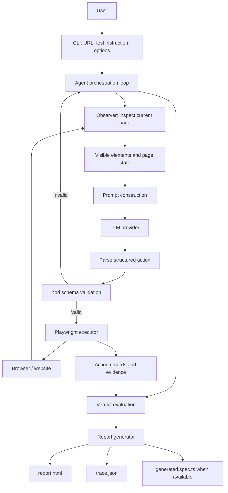
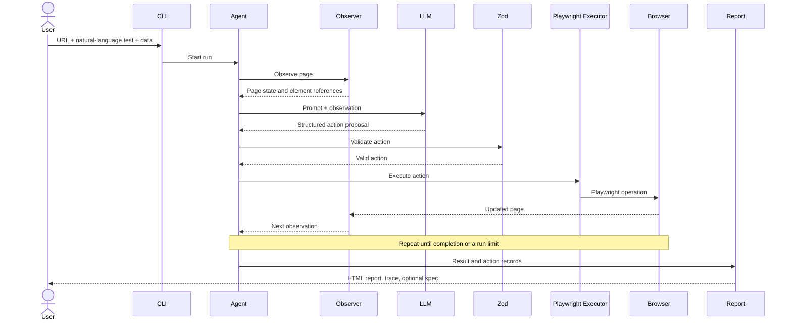

# Plain-English Test Runner — Architecture

## 1. Overview

Plain-English Test Runner converts a natural-language browser testing instruction into constrained browser actions. The LLM proposes structured actions, Zod validates them, Playwright executes them, and the runner evaluates the test verdict.

## 2. System Architecture

## 3. Execution Sequence

## 4. Component Responsibilities

| File | Responsibility |
|---|---|
| `src/cli.ts` | Reads command-line arguments, URL, test instruction, options, and environment-based test data; starts the run. |
| `src/agent.ts` | Coordinates the observe–plan–validate–execute loop, tracks progress and limits, and computes the verdict. |
| `src/observer.ts` | Inspects the current browser page and exposes visible elements and temporary references. |
| `src/prompt.ts` | Builds the instructions and context sent to the LLM, including the supported action format. |
| `src/llm.ts` | Handles communication with the configured LLM provider and returns its response for parsing. |
| `src/schema.ts` | Defines supported structured actions and validates proposed payloads with Zod. |
| `src/executor.ts` | Maps validated actions to Playwright operations and records execution outcomes. |
| `src/report.ts` | Generates run artifacts such as HTML reports, JSON traces, and generated Playwright specifications when available. |

## 5. Agent Workflow

1. **Initialize:** CLI reads the target URL, test goal, options, and test data.
2. **Observe:** Observer inspects the current page and its visible elements.
3. **Plan:** Prompt and observation are sent to the LLM for the next action.
4. **Validate:** The proposed action is parsed and checked against the Zod schema.
5. **Execute:** Executor performs the validated action using Playwright.
6. **Re-observe:** Agent inspects the updated page and decides whether another action is needed.
7. **Stop:** The loop ends on completion, a terminal condition, or a configured limit.
8. **Evaluate:** Runner computes the final verdict and writes evidence.

## 6. Verdict Semantics

| Verdict | Meaning |
|---|---|
| **PASS** | Requested assertions completed successfully and the agent finished. Expected negative behavior, such as an invalid-login message, can pass when it matches the test goal. |
| **FAIL** | An assertion was executed and its expected condition was not satisfied. |
| **ERROR** | Reliable verification could not be completed, such as an unreachable site, exhausted step limit, or no successful assertion. |

The verdict is determined by the runner's execution and assertion records, not solely by the LLM's statement.

## 7. Run Artifacts

Runs are stored in timestamped directories under `artifacts/`. A run may contain:

- `report.html` — human-readable report and action details.
- `trace.json` — machine-readable execution trace.
- `generated.spec.ts` — reusable Playwright test export when generated.

## 8. Security and Reliability

- Model output is a proposal, not trusted executable code.
- Action payloads are validated before execution.
- Browser operations are limited to supported executor actions.
- Test-data placeholders are resolved by the application; secrets should not be placed in prompts or committed.
- Execution is bounded by configured limits.
- Assertion failures are distinguished from execution or infrastructure errors.
- Review reports, traces, and screenshots for sensitive values before sharing.

## 9. Recorded Validation

Based on the execution log supplied for this project:

| Scenario | Result |
|---|---|
| Valid login and store page verification | PASS |
| Invalid login and expected authentication error | PASS |
| Product catalog and 20-products assertion | PASS |
| Registration form inspection | ERROR — step limit reached before completion |
| Missing `Order Archive 9147` heading | FAIL |
| Unreachable `.invalid` domain | ERROR — name resolution failure |
| Run without assertion | ERROR — no successful assertion |
| Redaction check | PASS — test secret not found in artifact files |
| Website-specific source scan | PASS — no searched target-site references in `src/` |
| Generated-spec replay | NOT VERIFIED — attempted path reported “No tests found” |

The source scan supports only the absence of the searched website names in `src/`; it does not prove successful operation on every website. Generated-spec replay remains pending until an exported spec runs successfully.

## 10. Design Principle

**LLM proposes → Zod validates → Playwright executes → runner verifies → report records.**

This separation constrains model actions, improves observability, and makes test results auditable.
