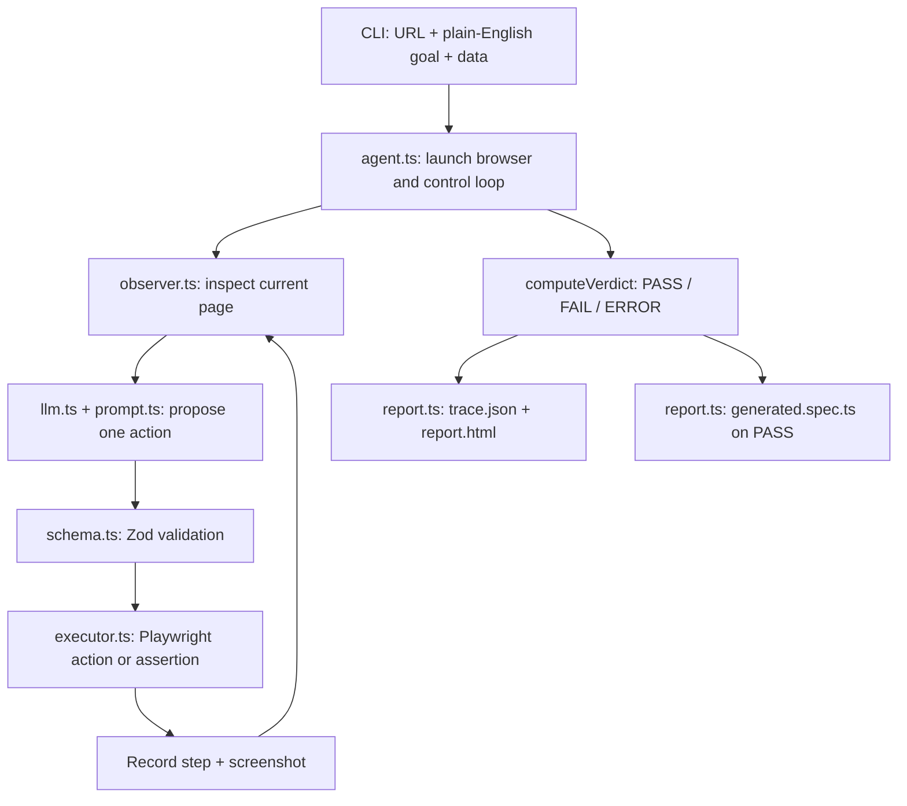

# Architecture overview

## Responsibilities

| Module | Owns | Must not own |
|---|---|---|
| `cli.ts` | Argument parsing, environment, configuration, suite dispatch | Browser interaction or model prompts |
| `agent.ts` | Browser lifecycle, loop state, recovery, verdict | Constructing model messages or executing arbitrary code |
| `llm.ts` | Provider request, parsing, retry, schema validation | Playwright APIs or page inspection |
| `prompt.ts` | Planner policy and context formatting | Browser state or verdict decisions |
| `schema.ts` | Action/data contracts and validation | Runtime orchestration |
| `observer.ts` | Current DOM summary and short-lived refs | LLM requests or test verdicts |
| `executor.ts` | Whitelisted Playwright actions and local secret substitution | Model calls or report rendering |
| `report.ts` | Console output and artifacts | Browser control or model calls |

## Trust boundaries

1. **Website → model:** page content is untrusted. It is included as data, not instructions.
2. **Model → executor:** all actions pass through Zod. Unknown actions and extra fields are rejected.
3. **Test data → model:** only data keys are sent. Values are substituted locally by the executor.
4. **Executor → verdict:** only Playwright assertions affect PASS/FAIL. Tool failures result in ERROR.
5. **Run → artifacts:** supplied data values are redacted from saved text output.
